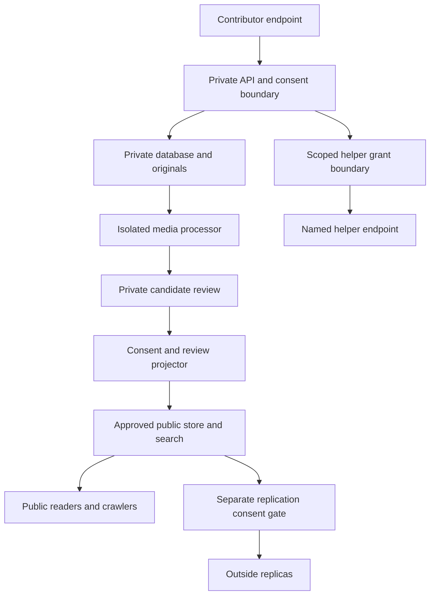

# HEARD threat model and privacy architecture

Status: design only; no deployment or E2EE certification. Unit HEARD-02.

## Components and trust boundaries

Public browser -> HEARD public web -> public approved content database/cache.
Authenticated or recoverable participant -> HEARD private intake boundary -> scoped Secure Intake adapter -> private case and encrypted object storage.
Privileged reviewer -> role-checked administration -> case and audit APIs.
Opt-in helper -> mediated permission service -> specifically granted limited records.
Approved editor -> review and consent gate -> sanitized publication derivative -> public archive and search.
Separate, further consent -> public replication export -> Liberty Nodes, if independently implemented.
External identity, object-storage, email, observability and hosting providers have distinct processing and metadata access. Do not assume any provider is blind to metadata.

## Data-flow classification

| Flow | Data | Sensitivity | Intended recipients | Protection and release gate |
|---|---|---|---|---|
| Rights browsing | public guide, anonymous request metadata | public/operational | web host, public reader | no account wall; minimize operational logs |
| Private question | text, optional contact, request metadata | restricted | participant, approved support staff | explicit processing notice, private access checks, no indexing |
| Experience | narrative, identity choices, context | restricted/high | participant, authorized case team | dedicated compartment, separate consent |
| Media and evidence | originals, embedded identifiers and metadata | high | allowed reviewer/storage processors | quarantine, authorization, immutable provenance, no public URLs |
| Volunteer offer | skills and contact | restricted | volunteer and limited matching staff | purpose limitation, no case access by default |
| Helper grant | allowed resource IDs, scope, expiration | high | participant, designated helper | explicit consent, expiry, revocation, audit |
| Public derivative | edited/reviewed content and provenance labels | public after approval | any visitor/search engine | consent, safety review, source labels, withdrawal process |
| Archive replication | approved public derivative | potentially permanent public | configured archive peers | new, separately explained irreversible-distribution consent |

## Threat actors and attack surfaces

- Harasser tries to identify pseudonymous users using public clues, exact dates, voice, EXIF, search snippets or repeated account handles.
- Malicious submitter sends malware, parser bombs, fabricated evidence, abusive content or attempts SQL/HTML injection.
- Insider with valid login attempts unauthorized case browsing, mass export, alteration or self-approval of publication.
- Compromised worker or API key attempts cross-tenant data access or exfiltration through logs and external requests.
- Unapproved collaborator uses broad grants, stale access tokens or message attachments to infer restricted identities.
- Hosting, email, model or observability provider may receive data or metadata outside declared purposes.
- Requester may misunderstand 'anonymous' as network anonymity or E2EE as compatible with server-side readable processing.

## Controls and abuse-resistant default decisions

Default-deny every private resource and service-to-service route; use stable subject/resource/action authorization rather than guessed identities. Bind grants to resources, scope, recipients and expiration; record changes and invalidate stale access. Compartmentalize encryption keys, databases, private originals and approved public projections; do not allow public CDN, analytics, search or error logs to receive restricted content. Minimize and retain metadata according to an approved, documented schedule. Validate uploads by size, type and isolated scanning before parsing or review; never directly serve unreviewed bytes. Separate security review of a redacted derivative from contributor publication consent, with different approvers for high-risk cases. Revocation prevents future HEARD access but cannot recall already copied public material; explain limitations.

Protect political independence by ensuring no default sharing with parties, donors or campaign systems. No legal representation or emergency responder is implied. Unsupported vendor choices, retention periods and security assertions remain open decisions.

## Negative verification matrix

| Scenario | Expected failure-safe behavior | Planned test |
|---|---|---|
| Anonymous story reveals original EXIF, voice or face | Block release until human redaction assessment; never guarantee untraceability | tests/security/reidentification |
| Private question leaks through search, analytics or URL previews | No restricted payload or sensitive preview field | tests/security/metadata |
| Volunteer views unrelated evidence | Deny access, audit denied attempt | tests/security/authorization |
| Participant withdraws helper grant | Subsequent access rejected; previously exported material limitation disclosed | tests/integration/grants |
| User asks question but never consents to publication | No public derivative or partner referral | tests/integration/consent |
| Public story has no two-stage consent/review | Publication denied | tests/integration/publication |
| Worker logs media transcript on failure | Structured redacted error only | tests/security/logging |
| E2EE badge appears while server can read plaintext | Claim must be absent; architecture rejected until independently demonstrated | tests/security/claims |
| Public content sent to distributed replication without separate approval | Export denied and auditable | tests/integration/replication |
| Donor or political account linked to participant | No automatic linkage, data export or enrollment | tests/security/independence |

## Risk register

| Risk | Severity | Mitigation owner | Residual uncertainty |
|---|---|---|---|
| Retaliation through reidentification | Critical | Privacy/security | Real-world deanonymization cannot be eliminated |
| Unauthorized insider access | Critical | Identity/case security | Provider and administrative control design pending |
| Irreversible unintended publication | Critical | Editorial/privacy | Distributed copies cannot always be recalled |
| Malicious files and parsers | High | Media security | Actual scanner and sandbox selection pending |
| Broad integration credential | High | Platform integrations | Exact adapter/service identity contract pending |
| Inaccurate legal advice | High | Editorial/legal | Qualified jurisdictional review capacity pending |

## Evidence and release discipline

This document is design evidence only. Downstream PRs must enumerate actual recipient and decryption-capable actors, encryption modes, key ownership, audit trails, retention policies, legal holds, and negative tests for the implemented flows. Link exact-head CI and operational results; never equate AI review with an independent audit or standards certification. No secret values are stored here.

## Versioned data map and component boundary

Version 1 (2026-11-01) is recorded in [../security/privacy-design.json](../security/privacy-design.json). It expands this design into 19 intended components, 16 flows and 10 negative scenarios, each with a stable ID, classification, purpose, intended business recipients, potential plaintext-capable actors, metadata observers, key-custody uncertainty, release gate, downstream requirements and initial test destination. Source baseline: `41b8c222629cc745e858abe3c50b7c8181f83f4d`.

This is a planned topology, not evidence of deployed connections. Storage and worker arrows remain restricted until a new explicitly approved public derivative passes the projector. Publication does not promote every field/file on a case. Outside copies and public metadata cannot be assumed retractable.

| Classification | Content boundary | Public treatment |
|---|---|---|
| C0 | Explicitly authorized public derivative and citations | Public only after applicable release gates |
| C1 | Private status, grants, decisions and operational metadata | Never public merely because related case is published |
| C2 | Confidential narrative, evidence originals and private media | Separate authorized recipient/resource access |
| C3 | Identifying/sealed fields, contact and identity keys | Separate compartment and dual-control or recipient cryptographic access |

### Key custody and actual exposure

Intended recipients describe the business purpose; plaintext-capable actors record potential technical exposure and do not authorize it. A database, object-storage processor or scoped infrastructure operator may be able to read managed content through held keys or control-plane access. Provider details are deliberately **unverified** until implementation and runtime assessment establish them. Transport encryption and storage encryption alone never establish provider blindness or E2EE.

| Design path | Potential content readers | Required custody decision / evidence |
|---|---|---|
| Managed private questions/cases (F02/F03/F07) | Contributor, scoped API, assigned reviewer; database/backup/provider operators may be capable | Per-purpose service roles, separate compartments, key rotation/recovery and actual access tests |
| Original media and processing (F04/F05) | Contributor, authorized storage, leased processor and assigned reviewer; infrastructure exposure must be assessed | Single-object grants, quarantine, worker egress/isolation, private derivative storage and byte/version provenance |
| Identity compartment (F06) | Contributor and explicitly authorized identity path; managed API/database/operator capability remains unresolved | Separate keys/roles, controlled reveals and audit; recovery secrets stored as one-way verifiers; admin role alone is insufficient |
| Helper grants (F09) | Named helper for approved resources plus necessary scoped managed processors | Recipient/resource/action/purpose/expiry, revocation at API and storage; prior copies cannot be recalled |
| Protected messaging (F16) | Intended endpoint participants only; provider content access must not be assumed absent without evidence | Profile unavailable and path disabled. Pin and test actual protocol/key enrollment/rotation/recovery before E2EE claims; no silent managed fallback |
| Notifications/telemetry (F12/F13) | Selected providers and scoped operators see necessary minimized metadata | No allegations, private titles, attachments, bearer URLs or recovery secrets in provider payloads, logs or exception traces |
| Public release/replication (F10/F11) | Anyone, including outside copiers | Current contributor consent, reviewed derivative/version and separate replication consent; confidentiality ends only for allowlisted released data |

Private API responses require no-store/cache isolation, authorization and minimized URLs. Backups, temporary uploads, browser draft storage, worker crash files, audit exports, support tooling and deletion/legal holds belong in the implementation-bound inventory; this design does not assert that those paths are absent. Retention periods, vendor jurisdictions, key custodians and lawful-request procedures remain explicit policy decisions, not invented defaults. Direct public-source citation reads do not grant any HEARD-to-FOIA private write path. Core SSO conveys identity only, never case, party, donor or campaign permissions.

### Negative-test handoff and risk ownership

The JSON scenarios bind each attack to affected flows, threat actors, expected safe failure and a planned test destination. All seven planned actor categories are covered: harasser, malicious submitter, insider, hostile collaborator, compromised worker, provider and unauthorized requester. `npm run check:privacy-design` rejects unknown endpoints/actors, missing required scenarios, restricted-to-public mappings and removed consent/identity/profile gates. The associated tests mutate the architecture record to verify the lint fails closed. They **do not execute the product attack scenarios**; downstream API, storage, UI, provider and recovery tests remain required.

| Additional risk | Severity | Accountable function | Required implementation evidence / remaining uncertainty |
|---|---|---|---|
| Provider/control-plane plaintext exposure | Critical | Privacy/platform | Actual custody and recipient map, IAM/key recovery tests; provider selection pending |
| Identity recovery or admin reveal overreach | Critical | Identity/security | Scoped proof/session and dual-control tests; real authorization integration pending |
| Metadata linkage through mail/logs/core SSO | High | Privacy/integrations | Payload/log inspection and linkage-negative tests; provider retention policies pending |
| Stale consent or job retry republishes withdrawn material | Critical | Editorial/platform | Atomic projection, version/revocation race and cache/index purge tests pending |
| Backup/browser/temporary-file scope omitted | High | Operations/security | Source/build/runtime discovery and restore/deletion evidence pending |

## E2EESA inventory framework and honest review status

[../security/e2eesa-inventory.json](../security/e2eesa-inventory.json) remains the incomplete source/runtime discovery record. [../security/privacy-design.json](../security/privacy-design.json) is a design input to that assessment, not a replacement for the pinned upstream component-inventory/scoped-assessment contracts. The pinned standard revision and three separate implementation/testing/independent-review states remain in `security/e2eesa-status.json`; no stage is completed by this PR.

For each implemented component/flow, reconcile actual source/build/runtime observations with this data map, identify real endpoints/processors/keys, retain exact version/digest/test evidence and record omissions/non-applicability with rationale. A mismatch or unknown processor must be resolved before the corresponding claim or sensitive flow is enabled. Preserve honest pending certification and expert-review status. Under the October 13 owner policy in `AGENTS.md`, substantive AI-assisted security review and automated/adversarial/integration tests can advance development and release; absence of external human review alone is not a blocker. Actual cryptographic, authorization, privacy, transaction, credential and test requirements remain in force. This document makes no security or anonymity certification claim.
